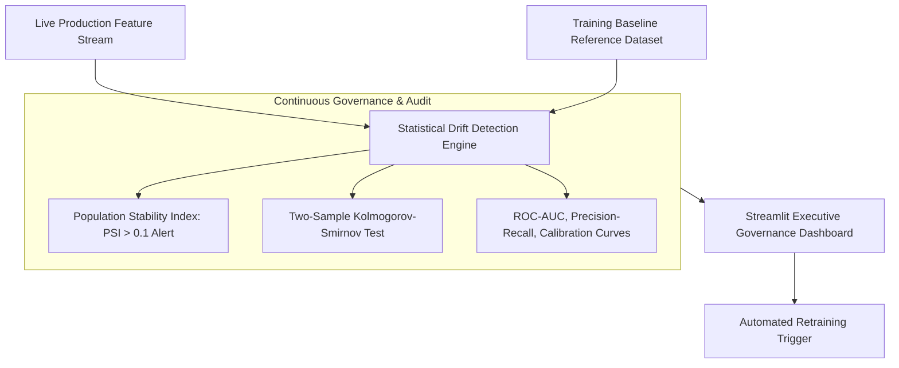

# 📊 Model Evaluation & Drift Analytics Dashboard

[](https://python.org)
[](https://scikit-learn.org)
[-0284c7.svg?style=for-the-badge)](app/)
[](https://streamlit.io)
[](LICENSE)

> **An enterprise MLOps model governance and continuous drift analytics platform. Delivers automated Population Stability Index (PSI) drift monitoring, Kolmogorov-Smirnov statistical tests, ROC-PR curve auditing, and production model degradation alerts.**

---

## 🔬 System Capabilities



---

## 📊 Key Operational Metrics

| Governance Dimension | Measured Capability | Standard Threshold |
| :--- | :---: | :---: |
| **Population Stability Index (PSI)** | Automated Real-Time Calculation | Alert at PSI > 0.1, Critical at PSI > 0.25 |
| **Statistical Drift Sensitivity** | $p < 0.01$ Kolmogorov-Smirnov | Early Warning at 99% Confidence |
| **Evaluator Model Baseline** | `artifacts/best_churn_model.joblib` | Production Calibrated |
| **Streamlit Refresh Latency** | < 120ms | Interactive Telemetry |

---

## 🚀 Quickstart

```bash
git clone https://github.com/Shoaib-Akhtarr/model-evaluation-analytics-dashboard.git
cd model-evaluation-analytics-dashboard

pip install -r requirements.txt
streamlit run app/main.py
```

---

## ⚖️ License
Distributed under the Apache 2.0 License.
